 

---

### 👋 About me

I'm a **Junior Full-Stack Developer at KFS Group**, and in my own time I run **[Elixify](https://elixify.hu)**, a small studio doing web design, development and AI automation. I like turning rough ideas into polished, fast products, from the UI all the way down to the server.

- 🔭 Building: custom web apps, automations and a few game-server projects
- 🌱 Leveling up: TypeScript, modern frontend, backend architecture, AI workflows
- 💬 Ask me about: web dev, automation, server tuning, Minecraft plugins

### 🛠️ Toolbox

### 📊 GitHub at a glance

### 📌 Featured projects

<!-- Replace REPO_NAME with your public repos (copy this line for each one) -->

### 🐍 Contribution snake

  <picture>
    <source media="(prefers-color-scheme: dark)" srcset="https://raw.githubusercontent.com/Szabolcs05/Szabolcs05/output/github-snake-dark.svg"/>
    
  </picture>

